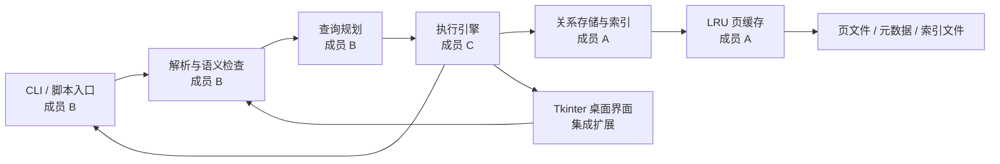

# 02 架构与接口约定

**状态：接口基线 v1，已固定。** 可直接按 `dbms/types.py` 和 `dbms/contracts.py` 开发。两份 Python 文件是字段、类型与方法签名的唯一依据；本文解释行为语义。若需要改公开接口，先同步更新代码契约、本文和相关测试，再通知三位成员。

## 1. 数据流与负责边界



成员 B 只产生计划，不直接读写数据库文件；成员 C 只通过存储接口访问行；成员 A 不解析 SQL。目录建议如下：

```text
dbms/
  __main__.py             # python -m dbms，成员 B
  types.py                # 已固定的共享数据类型/异常
  contracts.py            # 三人共用的 CatalogPort、StoragePort 与函数类型
  frontend/               # 词法、解析、语义检查、规划，成员 B
  executor/               # 计划执行，成员 C
  storage/                # catalog、heap、索引、buffer，成员 A
tests/
  unit/                   # 各成员本模块测试
  integration/            # 跨模块测试，成员 C 组织
examples/demo.sql         # 三人共同维护的演示脚本
```

## 2. 共用类型与公开接口

以下数据结构已在 `dbms/types.py` 实际定义。字段名、类型和语义属于接口约定；内部类和私有函数自行决定。数据类本身不做运行时校验，B 在规划阶段校验 SQL，A 在存储 API 边界再次校验。

| 类型 | 字段或语义 |
| --- | --- |
| `Column` | `name: str`, `type: Literal['INT','TEXT']` |
| `TableSchema` | `name: str`, `columns: tuple[Column, ...]`，列名唯一 |
| `RID` | `page_no: int`, `slot_no: int`；表名不含在 RID 内，使用时另传表名 |
| `RowRef` | `rid: RID`, `values: tuple[int \| str, ...]`，值顺序与 schema 一致 |
| `Predicate` | `column: str`, `op: str`, `value: int \| str` |
| `Result` | `columns: tuple[str, ...]`, `rows: list[tuple[Value, ...]]`, `affected_rows: int`, `plan_label: str`；非 SELECT 的 `columns` 和 `rows` 为空 |
| `BufferStats` | `hits`, `misses`, `evictions`, `dirty_flushes`，均为非负整数，供测试与演示读取 |

异常统一继承 `DBMSError`：`SQLSyntaxError`、`SchemaError`、`TypeMismatchError`、`StorageError`。CLI 捕获并显示错误；模块内部不得直接打印错误。表名和列名由前端统一转小写；存储层也须检查入参，防止绕过前端时写入非法数据。`bool` 不是合法 `INT`；`INT` 范围为 `[-2^63, 2^63-1]`；`TEXT` 限制为 UTF-8 编码后最多 255 字节。

### 2.1 成员 A 提供给 B、C 的 `StorageEngine`

```python
class StorageEngine:
    def __init__(self, db_dir: str, buffer_pages: int = 64): ...
    def get_schema(self, table: str) -> TableSchema: ...
    def has_index(self, table: str, column: str) -> bool: ...
    def list_tables(self) -> tuple[str, ...]: ...
    def create_table(self, schema: TableSchema) -> None: ...
    def create_index(self, name: str, table: str, column: str) -> None: ...
    def insert(self, table: str, values: tuple[int | str, ...]) -> RID: ...
    def scan(self, table: str) -> Iterator[RowRef]: ...
    def lookup_eq(self, table: str, column: str, value: int | str) -> Iterator[RowRef]: ...
    def update(self, table: str, rid: RID, values: tuple[int | str, ...]) -> None: ...
    def delete(self, table: str, rid: RID) -> None: ...
    def get_buffer_stats(self) -> BufferStats: ...
    def flush(self) -> None: ...
    def close(self) -> None: ...
```

`StorageEngine` 实现 `dbms.contracts.StoragePort`（它也包含只读的 `CatalogPort`），其构造签名固定为 `StorageEngine(db_dir: str, buffer_pages: int = 64)`。`scan` 仅返回未删除行。`lookup_eq` 没有索引时抛 `SchemaError`，有索引时返回所有匹配的当前行；执行器仍复核谓词。`update` 的 `values` 是**整行的新值**，不是单列值。为了保持 RID 稳定，**MVP 规定更新后的编码记录不得超过原记录占用空间**，超过时抛 `StorageError`。若希望支持变长更新，三人须先明确 RID 迁移规则、同步修改接口并补充测试。`delete` 对已删除或不存在的 RID 抛 `StorageError`。`close` 调用 `flush`，可重复调用；关闭后的其他方法不得继续使用。

图形界面扩展增加了只读的 `list_tables() -> tuple[str, ...]`，按表名排序返回当前数据库中的表，不暴露 catalog 文件或存储内部结构。原有 SQL 及存储行为不变。

索引名称在同一数据库中全局唯一。`get_buffer_stats()` 返回当前计数的快照，不允许调用者修改内部计数器。`get_schema` 查不到表时抛 `SchemaError`；`has_index` 对不存在的表/列也抛 `SchemaError`，对存在但未建索引的列返回 `False`。

### 2.2 成员 B 提供给 C 的查询前端

```python
def parse(sql: str) -> Statement: ...
def plan(statement: Statement, catalog: CatalogPort) -> Plan: ...
```

`Statement` 为 `CreateTableStmt`、`CreateIndexStmt`、`InsertStmt`、`SelectStmt`、`UpdateStmt`、`DeleteStmt` 的联合类型，已在共享代码中定义。`SelectStmt.columns=None` 专门表示 `SELECT *`；其他 `columns` 是 SQL 中的列名顺序。`parse` 每次只接收一条 SQL，允许一个可选的末尾分号；多语句脚本的分句由 CLI 负责。`Plan` 为以下冻结的联合类型：

| 计划类型 | 必需字段 |
| --- | --- |
| `CreateTablePlan` | `schema` |
| `CreateIndexPlan` | `name`, `table`, `column` |
| `InsertPlan` | `table`, `values`（已按 schema 验证） |
| `SelectPlan` | `table`, `columns`（展开 `*` 后的列名元组）, `predicate`（可为 `None`）, `access`（`'seq'` 或 `'index_eq'`） |
| `UpdatePlan` | `table`, `column`, `value`, `predicate`, `access` |
| `DeletePlan` | `table`, `predicate`, `access` |

规划器检查表/列存在性、字面量类型及索引可用性。仅当谓词是 `=` 且对应列有索引时设 `access='index_eq'`，其余情况为 `'seq'`；没有谓词时必为 `'seq'`。`SELECT *` 在计划中展开为 schema 的列名元组。`CREATE INDEX` 的表列合法性由前端检查，索引重名与同列重复索引由存储层最终把关；`CREATE TABLE` 重名也由存储层最终把关。计划只包含数据，不持有文件句柄。

### 2.3 成员 C 提供给 CLI 的执行接口

```python
def execute(plan: Plan, storage: StorageEngine) -> Result: ...
```

执行器按计划调用 `scan` 或 `lookup_eq`，然后复核谓词、投影列，并负责 `UPDATE` 和 `DELETE` 的影响行数。修改时先把匹配行物化为列表，再逐行调用存储接口，以免遍历过程中改变索引或页布局。CLI 负责将 `Result` 格式化为表格，不在执行器中打印。`Result` 约定如下：

| 计划 | `columns` / `rows` | `affected_rows` | `plan_label` |
| --- | --- | --- | --- |
| `SelectPlan` | 投影列名 / 查询到的值 | `0` | `SeqScan` 或 `IndexEqScan` |
| `CreateTablePlan` | 空 / 空 | `0` | `CreateTable` |
| `CreateIndexPlan` | 空 / 空 | `0` | `CreateIndex` |
| `InsertPlan` | 空 / 空 | `1` | `Insert` |
| `UpdatePlan` | 空 / 空 | 实际修改行数 | `UpdateSeqScan` 或 `UpdateIndexEqScan` |
| `DeletePlan` | 空 / 空 | 实际删除行数 | `DeleteSeqScan` 或 `DeleteIndexEqScan` |

异常直接上抛，不构造表示失败的 `Result`。比较仅在相同类型间进行：`INT` 按数值比较，`TEXT` 按 Python 字符串的 Unicode 码点顺序比较。执行结果不承诺行顺序。

### 2.4 固定的公开导入路径

各成员在自己模块的 `__init__.py` 导出以下符号，其他模块只按这些路径导入：

```python
from dbms.storage import StorageEngine    # 成员 A 实现
from dbms.frontend import parse, plan     # 成员 B 实现
from dbms.executor import execute        # 成员 C 实现
from dbms.types import SelectStmt, SelectPlan, Result  # 按需导入共享类型
from dbms.contracts import CatalogPort, StoragePort  # 模拟对象与类型标注
```

公开函数不返回 `None` 代表失败；预期业务错误抛约定的 `DBMSError` 子类。内部实现可拆成任意文件，但不要让其他成员依赖内部文件路径。

## 3. 磁盘与缓存设计

| 文件 | 约定 |
| --- | --- |
| `catalog.json` | 数据库版本、表结构、索引定义；写入临时文件后替换 |
| `tables/<table>.heap` | 4096 字节定长页；页号从 0 开始 |
| `indexes/<table>__<column>.idx` | 等值哈希索引，键映射到 RID 列表；持久化且重启时可加载 |

每页建议采用页头（槽数、空闲空间边界）+ 槽目录（记录偏移、长度、删除标志）+ 行字节。行编码必须携带长度，按 schema 顺序序列化，且可区分 `INT` 和 `TEXT`。删除标记使 RID 稳定；页压缩、空间复用是增强项。索引键的编码必须稳定且区分类型，例如 `I:42` 与 `T:42`，不能用 Python 运行期随机哈希值落盘。

缓存以 `(heap_file, page_no)` 为键，容量由 `buffer_pages` 限定；命中移动到 LRU 最近端；替换脏页前写回；`flush` 写回全部脏页。提供可读取的 `hits`、`misses`、`evictions`、`dirty_flushes` 计数用于测试和演示。索引可整体载入内存，但必须在 `flush` / `close` 后持久化。单条语句成功后建议 `flush`，保证正常退出前即使 CLI 中断也可重启；不提供异常断电的原子性保证。

## 4. 边界规则

- 文本按 UTF-8 字节数限制；整数溢出报 `TypeMismatchError`；空表扫描返回空迭代器。
- `UPDATE` 修改索引列时先移除旧键、再加入新键；`DELETE` 移除对应索引项；重复键不能覆盖已有 RID。
- `CREATE INDEX` 必须扫描已有行建立索引。重复表名、索引名或同列重复索引报 `SchemaError`。
- 对外公开接口只使用上述类型，不传递页对象、文件路径或内部索引结构。
- SQL 标识符仅支持 ASCII 字母或下划线开头，后续可含数字；不支持引号标识符和注释。关键字大小写不敏感。数字字面量可带前导负号。CLI 脚本逐条执行；单引号内的分号不应截断语句。输出中需能看到查询计划标签，便于证明优化分支确实运行。
- 交互式 CLI 以 `.exit` 或 EOF 退出；脚本遇到错误应显示错误、继续执行后续语句，并最终以非零进程退出码报告存在错误。正常退出前必须调用 `storage.close()`；不承诺异常断电后的原子恢复。
